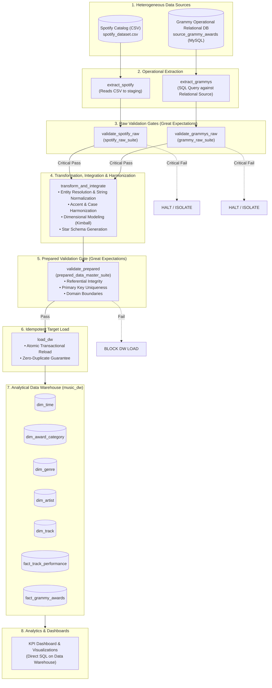

# System Architecture & Pipeline Design

**Course:** ETL (G01) — Faculty of Engineering and Basic Sciences  
**Academic Program:** Data Engineering and Artificial Intelligence  
**Institution:** Universidad Autónoma de Occidente (UAO)  
**Project:** Workshop-2: Building a Reliable Batch Data Pipeline  

---

## 1. High-Level Architecture Overview

The system implements a reliable, dual-gate batch data pipeline orchestrated by **Apache Airflow 3.1.8** using the modern **TaskFlow API** (`from airflow.sdk import dag, task`). It integrates two heterogeneous data sources:
1. **Spotify Streaming Catalog:** Provided as a semi-structured CSV dataset (114,000 track-genre entries).
2. **Grammy Awards History:** Extracted from a relational operational source table (`source_grammy_awards` in MySQL) rather than directly from CSV, satisfying the Section 4.3 engineering scenario requirement.

The analytical product is a trusted dimensional **Data Warehouse (Star Schema)** supporting executive KPIs and dashboards.

---

## 2. Core Architectural Principles

### Separation of Concerns
1. **Orchestration Logic (`dags/`):** Exposes task dependencies, execution flow, retry semantics, and DAG-level failure handling. It does NOT contain monolith business logic.
2. **Business & Quality Logic (`src/`):** Reusable, testable Python modules (`extract.py`, `validation.py`, `transform.py`, `load.py`).
3. **Data Quality Layer (`src/validation.py` & `gx/`):** Great Expectations suites enforce boundary conditions independently of pipeline flow.
4. **Relational Schemas (`sql/`):** Declarative SQL scripts (`source_setup.sql`, `dw_schema.sql`, `kpi_queries.sql`).

### Task Interfaces & Memory Hygiene
Tasks communicate solely by exchanging compact metadata objects (JSON dictionaries containing file paths, execution timestamps, row counts, and audit digests). Bulk DataFrames are never passed across the Airflow metadata database (XCom), guaranteeing high performance and horizontal scalability.

### Dual Validation Gate Pattern
- **Raw Validation Gate:** Verifies incoming source data safety *before* transformation logic touches it. Prevents malformed or toxic batches from entering compute cycles.
- **Prepared Validation Gate:** Verifies processed dimensions and facts *before* the Data Warehouse loader touches target storage. Ensures that schema invariants, foreign key referential integrity, and primary key uniqueness are strictly maintained.
